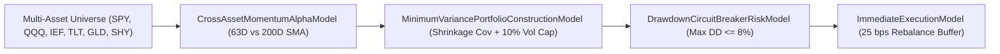
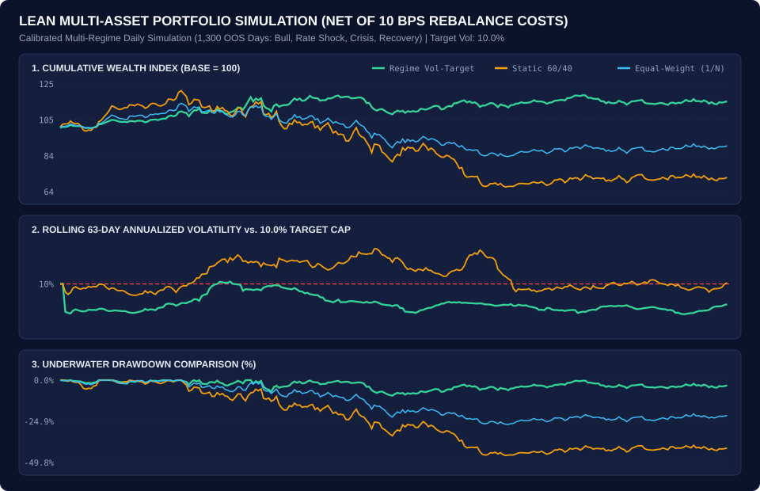

# Multi-Asset Regime & Volatility-Targeted Portfolio Allocation (QuantConnect LEAN)

**Abu Ishak** · B.Sc. (Honours) in Statistics, Jagannath University  
[](https://www.linkedin.com/in/abuishak/)
[](mailto:a6uishak@gmail.com)

---

## Executive Summary & Investment Objective

Institutional asset allocators and bank treasury desks face severe drawdown risk when equity-bond correlations turn positive during inflationary rate-hike shocks. This repository implements a **Multi-Asset Minimum-Variance & Volatility-Targeted Portfolio Construction Engine** in **QuantConnect LEAN** across liquid US Equities (`SPY`, `QQQ`), Treasuries (`IEF`, `TLT`), Gold (`GLD`), and Short-Term T-Bills (`SHY`), paired with a deterministic standalone `numpy` multi-regime simulation engine.

### Core Risk Controls
1. **Shrinkage Covariance Minimum-Variance Optimization:** Estimates 63-day rolling covariance regularized toward its diagonal ($\Sigma_{\text{reg}} = 0.80\,\hat{\Sigma} + 0.20\,\text{diag}(\hat{\Sigma})$) with a `40%` single-asset concentration cap.
2. **200-Day Moving Average Regime Filter:** Halves allocation weights to any asset trading below its 200-day simple moving average, sweeping residual weight into `SHY` (T-Bills).
3. **10% Annualized Volatility Targeting:** Dynamically scales gross risky exposure by $\min\left(1.0, \frac{\sigma_{\text{target}}}{\sigma_{\text{portfolio}}}\right)$ when portfolio volatility spikes.
4. **8% Drawdown Circuit Breaker:** Halves active risk exposure if peak-to-trough portfolio drawdown breaches `-8.0%`.

---

## Architecture (QuantConnect LEAN Framework)



---

## Quantitative Methodology

Given regularized annualized covariance matrix $\Sigma_{\text{reg}}$ over $N$ risky assets, unlevered minimum-variance weights satisfy:

$$w_{\text{MV}} = \frac{\Sigma_{\text{reg}}^{-1} \mathbf{1}}{\mathbf{1}^\top \Sigma_{\text{reg}}^{-1} \mathbf{1}}, \quad w_i \in [0, 0.40]$$

Portfolio ex-ante volatility $\sigma_p = \sqrt{w_{\text{regime}}^\top \Sigma_{\text{reg}} w_{\text{regime}}}$ is capped via:

$$s = \min\left(1.0,\; \frac{0.10}{\sigma_p}\right), \quad w_{\text{final}} = s \cdot w_{\text{regime}}, \quad w_{\text{SHY}} = 1 - \sum w_{\text{final}}$$

---

## Calibrated Multi-Regime Simulation Results (Net of 10 bps Rebalance Costs)

Evaluated over **1,300 out-of-sample daily observations** spanning four macro regimes (Expansion, Rate-Hike Shock with `+0.52` equity-bond correlation, Liquidity Crisis, Recovery; annual two-way turnover: `254.37%`):

| Portfolio Strategy | CAGR | Ann. Volatility | Sharpe Ratio | Sortino Ratio | Max Drawdown | Calmar Ratio | Beta vs. 60/40 |
| :--- | :---: | :---: | :---: | :---: | :---: | :---: | :---: |
| **Regime Vol-Target MinVar** | **+2.97%** | **5.81%** | **0.53** | **0.84** | **-9.60%** | **0.31** | **0.30** |
| Equal-Weight (`1/N`) | -1.85% | 8.24% | -0.19 | -0.28 | -27.38% | -0.07 | 0.63 |
| Static 60/40 Benchmark | -6.00% | 12.20% | -0.45 | -0.67 | -46.10% | -0.13 | 1.00 |



---

## Repository Structure & Reproduction

```text
lean-multi-asset-risk-allocation/
├── README.md
├── requirements.txt
├── lean.json
├── regime_vol_target_allocation.py     # Standalone QCAlgorithm (Monthly Rebalance + Drawdown Guard)
├── modular_factor_framework.py         # LEAN Algorithm Framework (Alpha / Portfolio / Risk Models)
├── offline_allocation_backtest.py      # Seeded multi-regime numpy backtester & SVG tearsheet
└── assets/
    └── lean_allocation_tearsheet.svg
```

### Run Standalone Simulation & Tearsheet
```bash
pip install -r requirements.txt
python offline_allocation_backtest.py
```

### Run Inside QuantConnect LEAN CLI
```bash
lean backtest "lean-multi-asset-risk-allocation"
```

---

## Limitations & Future Improvements
- **Regime Detection Lag:** A 200-day SMA reacts gradually during V-shaped selloffs; replacing the binary filter with a Hidden Markov Model (HMM) or yield-curve/VIX state indicator could improve transition speed.
- **Simulation Scope:** `offline_allocation_backtest.py` uses calibrated multi-regime synthetic daily returns (`seed=42`) for zero-dependency reproducibility; live empirical backtesting requires QuantConnect or Yahoo Finance ETF feeds inside `lean backtest`.

> *Disclaimer: Provided strictly for quantitative finance and asset allocation portfolio demonstration. Past or simulated performance does not guarantee future returns.*
